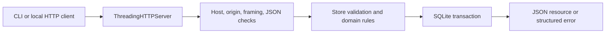

# Architecture and tradeoffs

## Request flow

`api.py` owns the HTTP contract; `core.py` owns persistence and business rules. `app.py` handles startup, atomic fixtures, and a temporary HTTP demonstration. Flat root files keep the small project inspectable and runnable without packaging steps.

## Persistence

Each operation opens its own SQLite connection with foreign keys enabled and a five-second busy timeout. Connections are never shared between request threads. WAL permits readers alongside a writer; SQLite still serializes writers.

Mutations use `BEGIN IMMEDIATE`, then validate related state, write, and commit in one transaction. Any failure rolls back the operation. Read operations use a transaction too, so order totals and page contents see one consistent snapshot. Database constraint conflicts become `409`; unavailable storage becomes `503` at the HTTP boundary.

| Table | Responsibility |
| --- | --- |
| `templates` | Current names, display prices, pickup windows, active/archive status |
| `branches` | Current location labels and open/closed state |
| `employees` | Branch reference, role and boolean active state |
| `orders` | Immutable identity/details snapshot plus current reservation state |
| `order_events` | Ordered state history with UTC timestamps |
| `idempotency` | Global key, normalized request hash, original response JSON |
| `demo_seed` | Marker ensuring fixture installation happens only once |

Indexes support order branch/status filters and history lookup. Orders sort by `createdAt` and ID for deterministic ties. Monetary display values are integers to avoid binary-float rounding. They do not represent a payment ledger. `boxesSold` is a compatibility field for collected synthetic units; metrics are derived from persisted orders, with no imported KPI constants.

The schema is bootstrap version 1 (`PRAGMA user_version`). Startup accepts an empty file or version 1 and refuses an unknown version. The project does not yet provide a general migration runner or downgrade procedure. Keep the schema file and database together when experimenting.

## Atomic order creation

1. Validate and normalize the input, including default quantity and whitespace.
2. Hash the normalized JSON in a stable key order.
3. Begin a write transaction and inspect the idempotency key.
4. Replay matching stored JSON, or reject a different fingerprint.
5. Verify the branch is open and the template active.
6. Insert the snapshot order, initial history event, and replay record.
7. Commit before returning the response.

The write lock prevents two concurrent requests from both creating an order for one key. A unique key constraint is the storage backstop. The test suite submits six real concurrent calls and verifies one order and one initial creation result.

Replay returns the **original** response, not a fresh view of the order. This makes retries deterministic. Clients use the returned ID to fetch current status. Keys persist across process restarts and are never automatically expired in this demo.

## State consistency

All order transitions pass through `Store.transition_order`. It reads the current state and appends an event in the same transaction as the state update. Terminal states have no outgoing transitions. Concurrent attempts therefore observe the last committed state instead of silently overwriting each other.

Template and branch edits do not rewrite order snapshots. Referenced templates/branches cannot be deleted, preserving history; archiving or closing is the appropriate reversible action. Employee branch labels are current labels because staff records are not historical transactions.

Pickup hours belong to a template rather than a dated inventory slot. No clock rule blocks collection or triggers expiry. This boundary keeps the state machine explicit while making the missing inventory/date model visible to a future integrator.

## HTTP boundary

The server binds to `127.0.0.1` or `localhost` only. It requires the exact local Host/port, rejects differing browser origins, emits no CORS permissions, and sets `Cache-Control: no-store`. These measures reduce accidental browser access; they are not authentication. Any local process can call the API.

Request JSON is limited to 16384 bytes. Reads time out after five seconds. Duplicate JSON keys, unsupported transfer encoding, unknown fields, repeated query parameters, and invalid scalar types are rejected. Route IDs and URL length are bounded. Collection responses include at most 100 records. HTTP/1.0 responses close connections after each request, avoiding unread-body reuse on error paths.

The standard-library threaded server has no worker pool or request-rate controls. It is selected for a transparent local example with no dependencies. A deployed version needs a suitable application server, authentication and authorization, audit/observability, and operational limits.

## Evidence and limits

`test_core.py` exercises the real SQLite domain model. `test_api.py` sends actual HTTP requests. `test_cli.py` launches independent CLI processes. All storage is temporary; tests do not use external services. The demo is reproducible evidence of a local lifecycle, not evidence of frontend integration, customer adoption, production uptime, paid reservations, or commercial results.

Suggested integration work is to define a dated stock model and authentication first, then add a typed frontend adapter. The existing Yummy UI's `paid` label must be replaced or backed by a separately designed payment system; it must never be inferred from this API's `reserved` state.
